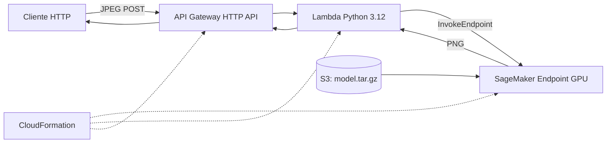

# ResUNet para segmentación dental en AWS — Instalación con CloudShell

Guía para desplegar una API de segmentación de radiografías dentales. El servicio recibe una imagen JPEG mediante HTTP y devuelve una máscara binaria PNG generada por ResUNet. La solución utiliza Amazon S3, SageMaker (GPU), Lambda, API Gateway HTTP API y CloudFormation.

**No es necesario entrenar el modelo:** el repositorio distribuye el checkpoint `model/resunet_best.pth` mediante Git LFS.

> **Advertencia:** SageMaker `ml.g5.xlarge` genera costos mientras el endpoint exista. La API es pública y no incorpora autenticación. Utiliza imágenes de prueba autorizadas, evita datos clínicos identificables y elimina la infraestructura cuando termines. Este proyecto es demostrativo y no constituye un dispositivo de diagnóstico médico.

## Arquitectura



La inferencia convierte la imagen a escala de grises, conserva la proporción mediante redimensionamiento y padding centrado a 640 × 640, normaliza a [0, 1] y devuelve una máscara PNG binaria de 640 × 640 (umbral 0.5). La máscara corresponde a la imagen con padding, no a las dimensiones originales.

## 1. Abrir CloudShell y verificar requisitos

1. Inicia sesión en la consola de AWS y selecciona **N. Virginia (`us-east-1`)**.
2. Abre **CloudShell** desde el icono de terminal de la consola.
3. Ejecuta **todos** los comandos siguientes en esa terminal Bash. No necesitas AWS CLI ni credenciales configuradas en tu computadora.

```bash
export AWS_REGION=us-east-1
export AWS_DEFAULT_REGION="$AWS_REGION"
aws sts get-caller-identity
aws --version
git --version
command -v tar
command -v sha256sum
command -v curl
```

La identidad de CloudShell necesita permisos para CloudFormation, IAM (incluido `iam:PassRole`), S3, SageMaker, Lambda y API Gateway. También se requiere cuota de SageMaker para **`ml.g5.xlarge`** en `us-east-1`. Si alguno de esos permisos o la cuota falta, un administrador deberá habilitarlo.

## 2. Obtener el repositorio y el checkpoint desde CloudShell

Clona el repositorio que contiene este README. Sustituye `<URL_HTTPS_DEL_REPOSITORIO>` por su dirección HTTPS real:

```bash
git clone <URL_HTTPS_DEL_REPOSITORIO>
cd resunet-aws-deployment
```

Si el repositorio remoto tiene otro nombre de carpeta, entra en la carpeta creada por `git clone`. Comprueba Git LFS:

```bash
if ! git lfs version; then
  sudo dnf install -y git-lfs
fi
git lfs install
git lfs pull
```

El paquete `git-lfs` debe estar disponible en los repositorios de la imagen de CloudShell. Si `dnf` no lo encuentra, consulta el procedimiento de instalación oficial de Git LFS para Amazon Linux y vuelve a ejecutar `git lfs pull`. **No continúes con un archivo puntero de LFS.**

Comprueba el tamaño y la integridad del checkpoint:

```bash
ls -lh model/resunet_best.pth
(cd model && sha256sum -c SHA256SUMS.txt)
```

El resultado de la segunda instrucción debe ser `resunet_best.pth: OK` y el archivo debe ocupar aproximadamente **371 MiB**.

**Almacenamiento:** CloudShell dispone de almacenamiento persistente limitado (habitualmente 1 GiB en el entorno clásico). Este proyecto empaqueta el modelo en flujo directamente hacia S3 para evitar crear otro archivo de cientos de MiB. Aun así, `git clone`, Git LFS y el checkpoint consumen espacio. Verifica `df -h .` y `du -sh .git model` antes de continuar; si no cabe, usa un entorno CloudShell con mayor capacidad o libera archivos que ya no necesites. No elimines el checkpoint antes del empaquetado.

## 3. Configurar automáticamente bucket, cuenta y rol IAM

El script de preparación obtiene el ID de cuenta con STS, crea o reutiliza un bucket privado y crea o reutiliza un rol de ejecución de SageMaker. No necesitas escribir manualmente identificadores de cuenta ni ARN.

```bash
source scripts/bootstrap_aws.sh
printf 'Cuenta: %s\nRegión: %s\nBucket: %s\nRol: %s\nVersión: %s\n' \
  "$AWS_ACCOUNT_ID" "$AWS_REGION" "$MODEL_BUCKET" "$EXECUTION_ROLE_ARN" "$MODEL_VERSION"
```

**Importante:** el script modifica recursos S3 e IAM. Debes contar con los permisos necesarios y revisar sus acciones si utilizas una cuenta corporativa. El rol creado tiene acceso de lectura al prefijo de artefactos del modelo. Las variables exportadas permanecen en la sesión actual; si abres otra sesión de CloudShell, ejecuta de nuevo `source scripts/bootstrap_aws.sh`.

## 4. Empaquetar el checkpoint y enviarlo a S3

```bash
bash scripts/package_model.sh
aws s3 ls "s3://$MODEL_BUCKET/deployment/resunet/$MODEL_VERSION/model.tar.gz" --region "$AWS_REGION"
```

El script transmite un `model.tar.gz` con `resunet_best.pth` y los archivos `code/model.py`, `code/inference.py` y `code/requirements.txt` directamente a S3, **sin guardar un segundo archivo grande en CloudShell**. El modelo se cargará desde esa ubicación al crear SageMaker.

## 5. Desplegar SageMaker mediante CloudFormation

Valida la plantilla y crea primero los recursos sin activar la instancia GPU:

```bash
aws cloudformation validate-template \
  --template-body file://cloudformation/sagemaker.yaml --region "$AWS_REGION"

aws cloudformation deploy \
  --template-file cloudformation/sagemaker.yaml \
  --stack-name resunet-sagemaker-gpu \
  --parameter-overrides \
    ExecutionRoleArn="$EXECUTION_ROLE_ARN" \
    ModelBucket="$MODEL_BUCKET" \
    ModelVersion="$MODEL_VERSION" \
    DeployEndpoint=false \
  --region "$AWS_REGION"
```

**A partir del siguiente comando se aprovisionará la GPU y comenzarán los cargos del endpoint:**

```bash
aws cloudformation deploy \
  --template-file cloudformation/sagemaker.yaml \
  --stack-name resunet-sagemaker-gpu \
  --parameter-overrides \
    ExecutionRoleArn="$EXECUTION_ROLE_ARN" \
    ModelBucket="$MODEL_BUCKET" \
    ModelVersion="$MODEL_VERSION" \
    DeployEndpoint=true \
  --region "$AWS_REGION"

export ENDPOINT_NAME="$(aws cloudformation describe-stacks \
  --stack-name resunet-sagemaker-gpu --region "$AWS_REGION" \
  --query "Stacks[0].Outputs[?OutputKey=='EndpointName'].OutputValue | [0]" \
  --output text)"

echo "$ENDPOINT_NAME"
aws sagemaker describe-endpoint --endpoint-name "$ENDPOINT_NAME" \
  --region "$AWS_REGION" --query EndpointStatus --output text
```

Espera a que el endpoint esté en estado `InService`. La creación puede tardar varios minutos.

## 6. Desplegar Lambda y API Gateway mediante CloudFormation

```bash
aws cloudformation validate-template \
  --template-body file://cloudformation/api.yaml --region "$AWS_REGION"

aws cloudformation deploy \
  --template-file cloudformation/api.yaml \
  --stack-name resunet-api \
  --parameter-overrides SageMakerEndpointName="$ENDPOINT_NAME" \
  --capabilities CAPABILITY_IAM \
  --region "$AWS_REGION"

export API_URL="$(aws cloudformation describe-stacks \
  --stack-name resunet-api --region "$AWS_REGION" \
  --query "Stacks[0].Outputs[?OutputKey=='ApiUrl'].OutputValue | [0]" \
  --output text)"

echo "$API_URL"
```

La API publica la ruta `POST /api/v1/segment`. `API_URL` se obtiene automáticamente de CloudFormation.

## 7. Obtener una imagen de prueba y ejecutar la API desde CloudShell

Para descargar un JPEG de prueba desde una **URL HTTPS directa** cuyo uso tengas autorizado, ejecuta:

```bash
export TEST_IMAGE_URL='<URL_HTTPS_DIRECTA_DE_UN_JPEG_AUTORIZADO>'
curl -fL "$TEST_IMAGE_URL" -o test.jpg
file test.jpg
```

No utilices la URL de una página HTML: debe apuntar al archivo JPEG. Si ya existe una imagen de prueba accesible en un bucket S3 con permisos de lectura, puedes copiarla **desde la terminal** sin subir nada por la interfaz gráfica:

```bash
# Alternativa a curl: reemplaza la URI por la ubicación real autorizada
aws s3 cp s3://BUCKET_DE_PRUEBAS/ruta/imagen.jpg test.jpg --region "$AWS_REGION"
```

Una vez disponible `test.jpg` en CloudShell:

```bash
curl --fail-with-body -sS -X POST "$API_URL" \
  -H 'Content-Type: image/jpeg' \
  -H 'Accept: image/png' \
  --data-binary @test.jpg \
  -o prediction.png \
  -w 'HTTP %{http_code} | tiempo total %{time_total}s\n'

file prediction.png
ls -lh prediction.png
```

El resultado esperado es **HTTP 200** y `prediction.png` (máscara binaria). Para comprobar el endpoint directamente desde CloudShell, sin Lambda ni API Gateway:

```bash
aws sagemaker-runtime invoke-endpoint \
  --endpoint-name "$ENDPOINT_NAME" \
  --content-type image/jpeg \
  --accept image/png \
  --body "fileb://$PWD/test.jpg" \
  --cli-binary-format raw-in-base64-out \
  --region "$AWS_REGION" "$PWD/direct-mask.png"
file direct-mask.png
```

## 8. Detener el endpoint y eliminar la infraestructura

Para **desactivar el endpoint GPU** conservando el modelo y la configuración de CloudFormation:

```bash
aws cloudformation deploy \
  --template-file cloudformation/sagemaker.yaml \
  --stack-name resunet-sagemaker-gpu \
  --parameter-overrides \
    ExecutionRoleArn="$EXECUTION_ROLE_ARN" \
    ModelBucket="$MODEL_BUCKET" \
    ModelVersion="$MODEL_VERSION" \
    DeployEndpoint=false \
  --region "$AWS_REGION"
```

Para **eliminar completamente ambos stacks**, primero la API y luego SageMaker:

```bash
aws cloudformation delete-stack --stack-name resunet-api --region "$AWS_REGION"
aws cloudformation wait stack-delete-complete --stack-name resunet-api --region "$AWS_REGION"

aws cloudformation delete-stack --stack-name resunet-sagemaker-gpu --region "$AWS_REGION"
aws cloudformation wait stack-delete-complete --stack-name resunet-sagemaker-gpu --region "$AWS_REGION"

aws sagemaker list-endpoints --region "$AWS_REGION" --output table
```

**Estos comandos no eliminan** el bucket S3, los objetos del modelo, el rol IAM creado por `bootstrap_aws.sh` ni necesariamente los logs de CloudWatch. Inspecciona esos recursos antes de eliminarlos para no afectar servicios compartidos. La eliminación de stacks puede tardar varios minutos.

## Estructura del proyecto

```text
cloudformation/
  sagemaker.yaml           Modelo, configuración y endpoint SageMaker
  api.yaml                 Lambda, API Gateway y permisos IAM
src/
  model.py                 Definición de la arquitectura ResUNet
  inference.py             Preprocesamiento y predicción
  requirements.txt         Dependencias de inferencia
model/
  resunet_best.pth         Pesos entrenados (Git LFS)
  SHA256SUMS.txt           Hash de integridad
scripts/
  bootstrap_aws.sh         Obtención de variables y recursos AWS
  package_model.sh        Empaquetado transmitido directamente a S3
examples/
  invoke_api.py            Cliente Python opcional
```

## Solución de problemas

- **`git lfs pull` falla:** comprueba la instalación de Git LFS, el acceso al repositorio y la cuota/almacenamiento disponible en CloudShell. Revisa `df -h .`.
- **Falla `sha256sum`:** el checkpoint no se descargó correctamente o es un puntero de Git LFS. No continúes hasta obtener `OK`.
- **`AccessDenied`:** revisa permisos de IAM, `iam:PassRole`, SageMaker y CloudFormation; puede existir una política de organización que impida crear recursos.
- **Error de cuota o capacidad:** verifica disponibilidad de `ml.g5.xlarge` en `us-east-1`.
- **Endpoint en `Failed`:** revisa logs de SageMaker/CloudWatch, permisos de lectura en S3 y la ruta del artefacto.
- **HTTP 502:** revisa el estado `InService` del endpoint y los logs de Lambda.
- **CloudFormation falla:** ejecuta `aws cloudformation describe-stack-events --stack-name NOMBRE_STACK --region "$AWS_REGION"`.

**Alcance:** esta guía está diseñada para AWS CloudShell en `us-east-1`. La infraestructura parametrizada no ha sido desplegada nuevamente como parte de esta actualización de documentación; valida los permisos, cuotas y políticas de tu cuenta antes de usarla.
